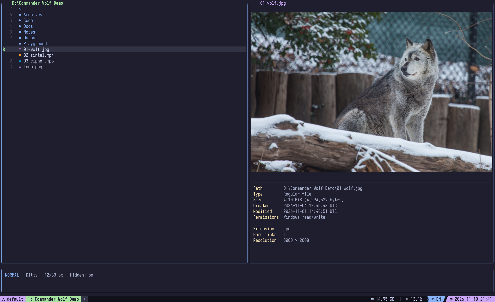
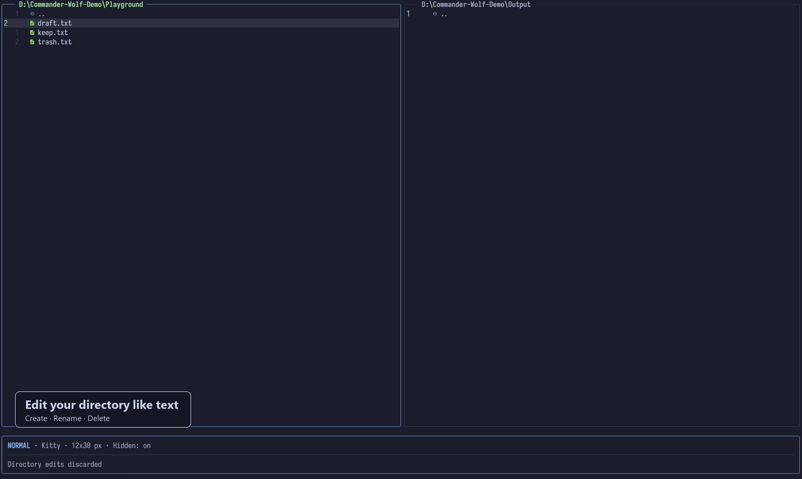
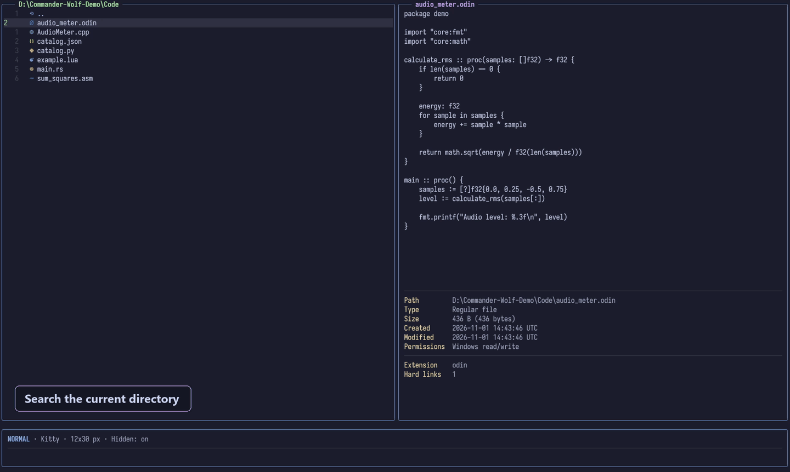
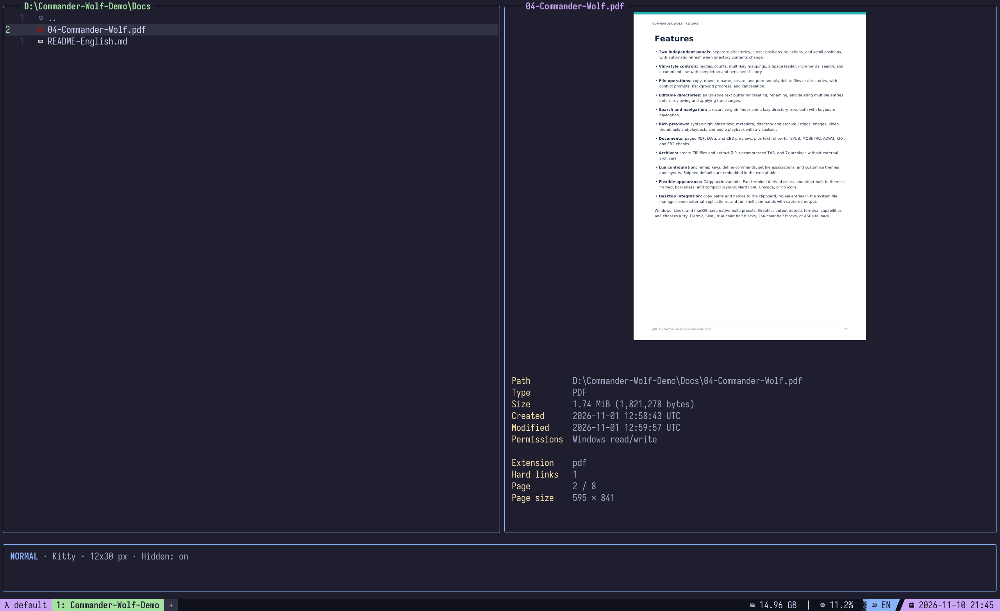
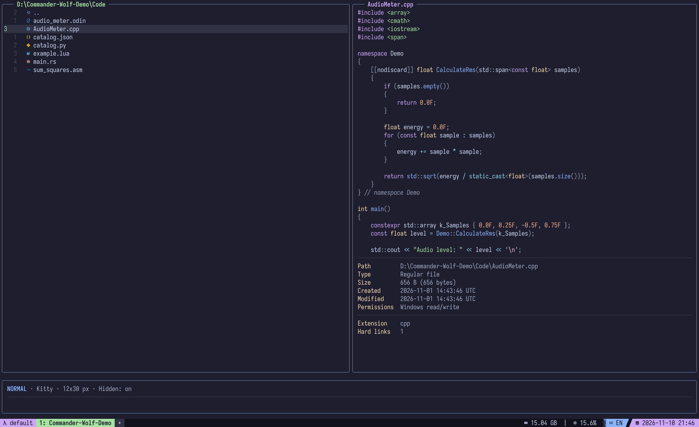
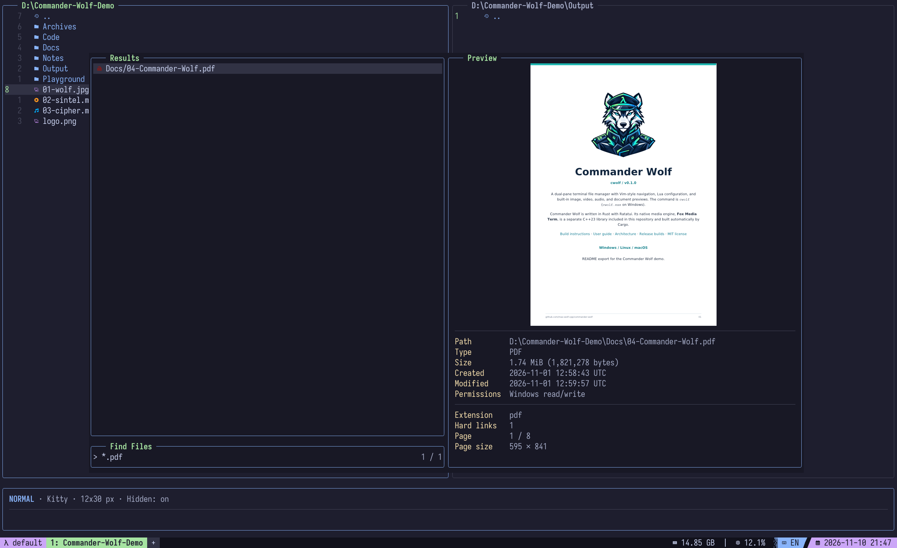
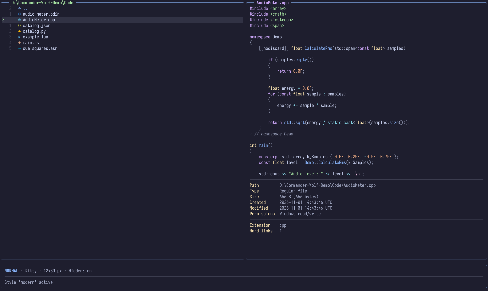
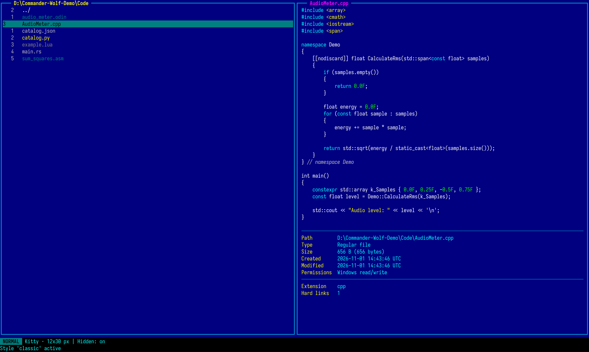
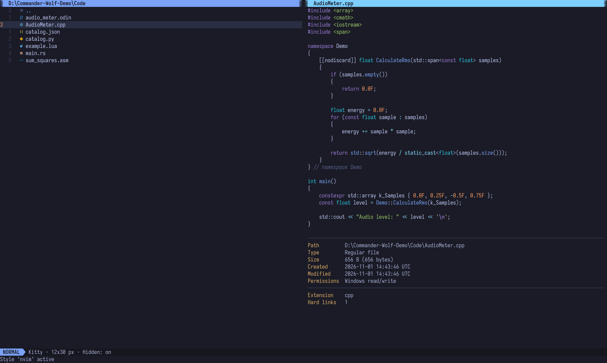

<p align="center">
  
</p>

<h1 align="center">Commander Wolf</h1>

<p align="center">
  <a href="Cargo.toml"></a>
  <a href="https://github.com/max-wolf-cpp/commander-wolf/actions/workflows/release.yml"></a>
  <a href="LICENSE"></a>
</p>

<p align="center">
  <a href="docs/building.md"></a>
  <a href="Cargo.toml"></a>
  <a href="docs/architecture.md"></a>
  <a href="docs/user-guide.md#user-configuration"></a>
  <a href="https://ratatui.rs/"></a>
</p>

A dual-pane terminal file manager with Vim-style navigation, Lua configuration, and built-in image, video, audio, and document previews. The command is **`cwolf`** (`cwolf.exe` on Windows).

Commander Wolf is written in Rust with Ratatui. Its native media engine, **Fox Media Term**, is a separate C++23 library included in this repository and built automatically by Cargo.

<p align="center">
  <a href="docs/building.md"></a>
  <a href="docs/user-guide.md"></a>
  <a href="docs/architecture.md"></a>
  <a href="docs/releases.md"></a>
</p>



*Catppuccin Mocha, modern style. Image preview and metadata alongside your files.*

## Features

- **Two independent panels:** separate directories, cursor positions, selections, and scroll positions, with automatic refresh when directory contents change.
- **Vim-style controls:** modes, counts, multi-key mappings, a Space leader, incremental search, and a command line with completion and persistent history.
- **File operations:** copy, move, rename, create, and permanently delete files or directories, with conflict prompts, background progress, and cancellation.
- **Editable directories:** an Oil-style text buffer for creating, renaming, and deleting multiple entries before reviewing and applying the changes.
- **Search and navigation:** a recursive glob finder and a lazy directory tree, both with keyboard navigation.
- **Rich previews:** syntax-highlighted text, metadata, directory and archive listings, images, video thumbnails and playback, and audio playback with a visualizer.
- **Documents:** paged PDF, DjVu, and CBZ previews, plus text reflow for EPUB, MOBI/PRC, AZW3, KFX, and FB2 ebooks.
- **Archives:** create ZIP files and extract ZIP, uncompressed TAR, and 7z archives without external archivers.
- **Lua configuration:** remap keys, define commands, set file associations, and customize themes and layouts. Shipped defaults are embedded in the executable.
- **Flexible appearance:** Catppuccin variants, Far, terminal-derived colors, and other built-in themes; framed, borderless, and compact layouts; Nerd Font, Unicode, or no icons.
- **Desktop integration:** copy paths and names to the clipboard, reveal entries in the system file manager, open external applications, and run shell commands with captured output.

Windows, Linux, and macOS have native build presets. Graphics output detects terminal capabilities and chooses Kitty, iTerm2, Sixel, true-color half blocks, 256-color half blocks, or ASCII fallback.

## See it in action

All examples use **Catppuccin Mocha + modern** in WezTerm on Windows.
Play the video clips below with sound; click a screenshot to inspect it at full size.

### Video and audio previews

Start playback with `p` and toggle mute with `m`, without leaving the file manager.

#### Video playback with sound · 16 seconds

https://github.com/user-attachments/assets/eece7d8d-ffe5-4f7a-9408-c3e091aa4afa

*Sintel* — © copyright Blender Foundation | [www.sintel.org](https://www.sintel.org/), [CC BY 3.0](https://creativecommons.org/licenses/by/3.0/). [Download MP4](docs/Media/video-preview.mp4).

#### Audio playback and visualization · 12 seconds

https://github.com/user-attachments/assets/767f2576-ebea-4461-aad4-f3a09435b97f

*"Cipher"* — Kevin MacLeod ([incompetech.com](https://incompetech.com/music/royalty-free/index.html?isrc=USUAN1100844)), [CC BY 4.0](https://creativecommons.org/licenses/by/4.0/). [Download MP4](docs/Media/audio-preview.mp4).

### Edit a directory like text

Press `i`, edit names or add and remove lines, then press Esc to review the
planned changes. Apply them together with `y`. This example creates, renames,
and deletes entries, then shows the result.



### Find a name in the current panel

Type `/catalog`, press Enter, and use `n` / `N` to move between matches.



### Preview documents and source code

Read PDF pages and syntax-highlighted code alongside the directory listing.
Use `]` / `[` to turn document pages.

| PDF pages and metadata | Syntax-highlighted C++ |
|---|---|
| [](docs/Media/pdf-preview.png) | [](docs/Media/code-preview.png) |

### Search through subdirectories

Press Space, `f`, `f`, enter a glob such as `*.pdf`, and press Enter to search.
Preview the selected result before opening it.

[](docs/Media/finder.png)

[Demonstration media credits and licenses](docs/Media/CREDITS.md).

## Install and run

If you use an archive from [Releases](https://github.com/max-wolf-cpp/commander-wolf/releases), extract the **entire archive** into one folder. Keep the executable and its accompanying shared libraries together. This is currently a multi-file application; copying only `cwolf.exe` is insufficient.

Run it from a terminal:

```sh
cwolf
cwolf /path/to/directory
cwolf /path/to/file
cwolf --clean .
cwolf --protocol hb-tc .
```

A file argument selects that file in its containing directory. `--clean` ignores user configuration and does not read or write session/history state. `--protocol` overrides automatic graphics selection; accepted values are `auto`, `kty`, `it2`, `sxl`, `hb-tc`, `hb-256`, and `ag`.

On Windows, use `.\cwolf.exe` when launching from its folder in PowerShell. On Linux and macOS, use `./cwolf` if it is not on `PATH`.

A Nerd Font 3.3 or newer is needed for the default icons. Use `:icons unicode` or `:icons none` if your font does not include those glyphs. Graphics quality and playback speed depend on the terminal and selected protocol.

## Build from source

Build prerequisites:

| Component | Requirement |
|---|---|
| Rust | Current stable Rust with Cargo and Rust 2024 edition support |
| Native build | CMake 3.24+, Git, and a bootstrapped vcpkg checkout |
| Windows | Clang-CL, Ninja, MSVC C++ build tools, and the Windows SDK; use an x64 Visual Studio developer shell |
| Linux | Clang 19+ with a compatible libstdc++ (or another C++23-capable standard library), Ninja, and native build tools |
| macOS | Full Xcode 26+ with AppleClang and a C++23-capable standard library |

Set `VCPKG_ROOT` to your vcpkg checkout, then run:

```sh
git clone https://github.com/max-wolf-cpp/commander-wolf.git
cd commander-wolf
cargo build --release --locked
cargo run --release --locked -- .
```

The resulting executable is `target/release/cwolf.exe` on Windows or `target/release/cwolf` on Linux/macOS. `cargo build` produces a Debug build under `target/debug` instead.

Cargo builds Fox Media Term through CMake, installs it into Cargo's build output, and stages its shared library beside the executables. On Windows it also stages app-local native dependencies. **There is no separate manual media-library build step.** The first build downloads and compiles dependencies and can take a while.

See [Building and testing](docs/building.md) for platform setup, vcpkg bootstrap commands, native dependencies, runtime libraries, native tests, and common build failures. [Release builds](docs/releases.md) covers local Windows packaging and the manually dispatched GitHub Actions matrix, which only runs in a public repository and prepares draft releases.

## Essential controls

The default leader is **Space**. Press the keys in a sequence one after another; for example, Space then `p` toggles preview.

| Key | Action |
|---|---|
| `?` | Show all active key bindings |
| `Tab` | Switch panels |
| `j` / `k`, Down / Up | Move; counts such as `10j` are supported |
| `h` / `l` | Parent directory / enter directory |
| `gg` / `G` | First / last entry |
| Enter | Enter a directory, view an image, or open a file externally |
| Space, `s` / `v` | Toggle a mark / begin visual selection |
| `F5` / `F6` | Copy / move the selection to the other panel |
| Space, `r` | Rename the current entry |
| `Shift+F8` | Confirm permanent deletion |
| `i` | Edit directory entries as text |
| `/`, `n` / `N` | Search this panel, then next / previous match |
| Space, `f`, `f` / Space, `t` | Recursive finder / directory tree |
| Space, `p` | Toggle preview |
| `p` / `m` | Start or stop preview playback / toggle mute |
| `]` / `[` | Next / previous document page |
| Space, `y`, `p` / Space, `y`, `n` | Copy full path / name |
| Space, `z`, `a` / Space, `z`, `x` | Create a ZIP / extract an archive |
| `:` | Enter a command; `:!command` runs a shell command |
| Esc | Cancel or close the active interaction |
| `q` / `:q` | Quit from the main view |

The [user guide](docs/user-guide.md) covers commands, selection rules, conflict handling, cancellation, finder patterns, playback, and all configuration options.

## Themes and styles

Choose colors and presentation independently. These screenshots show the same
file and preview in three combinations; click a screenshot to view it at full size.

| Catppuccin Mocha · modern | Far · classic | Tokyo Night · nvim |
|---|---|---|
| [](docs/Media/theme-catppuccin-modern.png) | [](docs/Media/theme-far-classic.png) | [](docs/Media/theme-tokyonight-nvim.png) |
| `:theme catppuccin_mocha`<br>`:style modern` | `:theme far`<br>`:style classic` | `:theme tokyonight_night`<br>`:style nvim` |

Use these commands to try a combination for the current session, or set it in Lua
as shown below. `modern` uses rounded frames; `classic` uses double panel frames,
colored file names, and no icons; `nvim` keeps the main panels and footer borderless.

## Configuration

Configuration is optional and **Lua-only**. Create `init.lua` at:

| Platform | Location |
|---|---|
| Windows | `%LOCALAPPDATA%/commander-wolf/init.lua` |
| Linux and macOS | `$XDG_CONFIG_HOME/commander-wolf/init.lua`, or `~/.config/commander-wolf/init.lua` when unset |

```lua
local wolf = require("commander_wolf")

wolf.theme.use("catppuccin_mocha") -- Also try "far" or "terminal".
wolf.style.use("modern") -- modern, nvim, classic
wolf.style.icons = "nerd_font" -- nerd_font, unicode, none
wolf.option.set("workspace.show_hidden", true)
wolf.option.set("session.remember_directories", true)

-- Optional: an explicit text editor for text files and Space, o, c.
wolf.file_association.set_text_editor("nvim")
```

The default combination is Catppuccin Mocha with the modern style. Themes and styles are independent, and all defaults work without a configuration file. A broken configuration falls back to shipped defaults and reports the error. Use `cwolf --clean` to diagnose configuration problems.

See the [Lua configuration reference](docs/user-guide.md#user-configuration) for keymaps, custom commands, file associations, theme definitions, and the public `wolf` API.

## Current scope

- Mouse buttons and the wheel do not control the application; keyboard control is the supported workflow.
- Audio and video never autoplay. Playback supports start/stop and mute, with no seeking, pause/resume, or playlist.
- Document previews are lightweight views, not full document readers. Ebook layout is reflowed text; DRM and encrypted PDFs are unsupported.
- Archive creation produces new ZIP files. RAR, password-protected archives, and compressed TAR extraction are unsupported.
- Deletion is permanent. Cancellation stops further work; completed file operations are not generally rolled back.
- Clipboard and system-file-manager actions need the corresponding desktop services. Shell command output is captured; interactive terminal programs should be opened through the editor/file-association integration.

## Development and bug reports

```sh
cargo fmt --all --check
cargo test --workspace --locked
cargo clippy --workspace --all-targets --locked -- -D warnings
```

Native C++ tests are run separately through CTest; see [Building and testing](docs/building.md#native-library-and-tests). The [architecture overview](docs/architecture.md) describes the Rust/native boundary and state/effect model.

Please report problems in [Issues](https://github.com/max-wolf-cpp/commander-wolf/issues), including your OS, terminal and version, Commander Wolf version, reproduction steps, and expected versus actual behavior. For rendering problems, include the protocol shown in the footer and whether `--clean` changes the result. Small sample files and screenshots are useful when relevant.

## License and acknowledgements

Commander Wolf's original code, including the included Fox Media Term sources and Rust bindings, is licensed under the [MIT License](LICENSE), copyright © 2026 Max Wolf.

Third-party components retain their own licenses. Vendored `nvim-web-devicons` data includes its [original MIT license](Vendor/NvimWebDevicons/LICENSE). See [Third-party notices](THIRD_PARTY_NOTICES.md) for dependency sources and licensing information.

The photographs, film, and music shown in the README retain their own licenses; see [Demonstration media credits](docs/Media/CREDITS.md).
